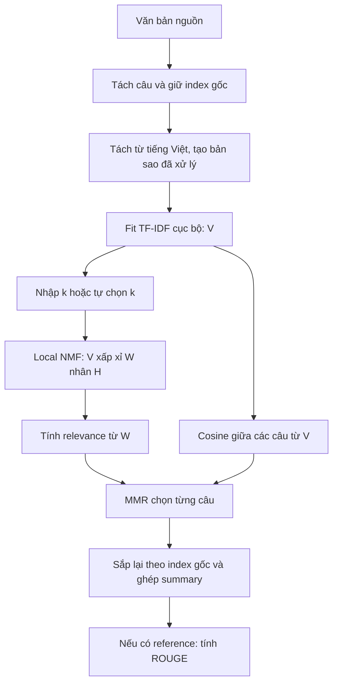

# Cẩm nang dễ hiểu về NMF và hệ thống TopicSum

> Cập nhật theo code, web và các ví dụ chạy ngày **15-10-2026**. Đây là tài liệu để học, đọc hiểu hệ thống và chuẩn bị báo cáo. Các số liệu có ghi **ví dụ tính tay** là số đơn giản hóa để giải thích công thức; các số liệu có ghi **chạy thật** được lấy từ code dự án. Ví dụ một bài không phải kết quả benchmark trên corpus.

## Cách đọc tài liệu này

Bạn không cần biết hết đại số tuyến tính để đọc phần đầu. Hãy đi theo thứ tự: văn bản → số hóa câu → tìm chủ đề → chọn câu → đánh giá bản tóm tắt. Bấm vào số chương trong bảng để đi đến phần cần đọc.

| Bạn muốn hiểu gì? | Phần nên đọc |
| --- | --- |
| Hệ thống nhận gì, trả gì? | [1-3](#chuong-1) |
| TF-IDF, V, W và H là gì? | [4-7](#chuong-4) |
| Loss, KL, Frobenius và L1 hoạt động ra sao? | [8-11](#chuong-8) |
| Vì sao chọn k, tính điểm và giữ câu này? | [12-16](#chuong-12) |
| Một lần chạy thật cho kết quả gì? | [17](#chuong-17) |
| ROUGE và ablation được đọc thế nào? | [18-20](#chuong-18) |
| Đâu là giới hạn, đâu là điều có thể báo cáo? | [21-24](#chuong-21) |

Các công thức viết trong khối `text` để đọc được ngay trong Markdown. Ký hiệu `≈` nghĩa là xấp xỉ; `@` hoặc phép viết `WH` là nhân ma trận; `*` trong công thức cập nhật từng phần tử được giải thích riêng.

<a id="chuong-1"></a>

## 1. Hệ thống đang làm bài toán gì?

TopicSum nhận một văn bản tiếng Việt, chọn một số **câu nguyên văn** và ghép chúng theo thứ tự xuất hiện để tạo bản tóm tắt. Đây là tóm tắt **trích xuất**.

Ví dụ mặc định hiện tại có 12 câu nguồn và bạn yêu cầu giữ 4 câu. Hệ thống phải quyết định nên giữ những câu nào để vừa có thông tin quan trọng, vừa tránh chọn các câu gần trùng nhau.

NMF giúp tạo biểu diễn câu-chủ đề. MMR dùng biểu diễn đó và độ tương tự giữa các câu để quyết định câu được giữ. ROUGE được dùng sau đó khi có một bản tóm tắt tham chiếu.

Ba công việc này dùng ba loại điểm khác nhau:

| Đại lượng | Nó trả lời câu hỏi nào? | Tính từ đâu? |
| --- | --- | --- |
| Loss/objective NMF | Các ma trận W/H tái tạo dữ liệu đầu vào tốt đến đâu, với penalty đang chọn? | V và WH, cộng regularization. |
| Điểm MMR | Trong vòng chọn hiện tại, nên thêm câu nào? | Relevance của câu và similarity với các câu đã chọn. |
| ROUGE | Bản tóm tắt tạo ra giống reference về từ/ngữ đến đâu? | Summary và reference summary. |

**Không cần reference để fit NMF hoặc chọn câu. Cần reference khi chấm ROUGE.**

Tóm tắt trích xuất giữ dữ kiện/cách diễn đạt của câu gốc, nhưng việc bỏ các câu xung quanh vẫn có thể làm mất ngữ cảnh. Chẳng hạn câu bắt đầu bằng “Điều này…” có thể khó hiểu nếu câu giải thích trước đó không được giữ.

## 2. Mẫu AI hiện đang dùng trên web

Mẫu `test_nmf_01` nằm trong [data/demo/toy.json](../data/demo/toy.json). Ba trang đầu dùng chung bài **12 câu**; trang 03 có sẵn reference **4 câu**. Đây là nội dung minh họa do người dùng cung cấp, không phải bài báo hay số liệu thực tế đã được dự án xác minh.

> Trong thập kỷ qua, trí tuệ nhân tạo đã chuyển mình từ một khái niệm nghiên cứu trong phòng thí nghiệm trở thành động lực cốt lõi thúc đẩy kinh tế số tại Việt Nam. Các tập đoàn công nghệ lớn trong nước đang đầu tư hàng trăm triệu USD để xây dựng hạ tầng siêu máy tính và các trung tâm dữ liệu đạt chuẩn quốc tế. Việc làm chủ các mô hình ngôn ngữ lớn tiếng Việt giúp doanh nghiệp nội địa tối ưu hóa quy trình chăm sóc khách hàng và tự động hóa phân tích dữ liệu tài chính. Không chỉ dừng lại ở khối doanh nghiệp, ứng dụng học máy còn tạo ra bước ngoặt lớn trong lĩnh vực nông nghiệp công nghệ cao tại Đồng bằng sông Cửu Long. Hệ thống cảm biến kết hợp thị giác máy tính trên thiết bị bay không người lái cho phép nông dân phát hiện sớm sâu bệnh và theo dõi độ mặn của nguồn nước theo thời gian thực. Nhờ dự báo chính xác các yếu tố thời tiết cực đoan, sản lượng lúa chất lượng cao tại nhiều hợp tác xã đã tăng thêm hai mươi phần trăm trong khi giảm đáng kể lượng phân bón hóa học. Trong ngành y tế, các thuật toán học sâu hỗ trợ phân tích ảnh chụp X-quang và cắt lớp vi tính đang được triển khai thử nghiệm tại nhiều bệnh viện tuyến trung ương. Công nghệ phân tích ảnh y khoa giúp các bác sĩ sàng lọc sớm các dấu hiệu ung thư phổi và đột quỵ với độ chính xác cao, từ đó rút ngắn một nửa thời gian chẩn đoán lâm sàng. Tuy nhiên, quá trình chuyển đổi số sâu rộng bằng trí tuệ nhân tạo tại Việt Nam vẫn đang đối mặt với rào cản lớn về sự thiếu hụt nguồn nhân lực chất lượng cao. Theo các báo cáo thị trường công nghệ, nguồn cung kỹ sư chuyên sâu về dữ liệu và học máy hiện chỉ đáp ứng được khoảng một phần ba nhu cầu thực tế của các doanh nghiệp. Bên cạnh bài toán nhân sự, việc hoàn thiện hành lang pháp lý về bảo mật dữ liệu cá nhân và đạo đức máy tính cũng là yêu cầu cấp bách để phát triển bền vững. Để giải quyết triệt để các thách thức này, sự phối hợp chặt chẽ giữa các trường đại học, viện nghiên cứu và doanh nghiệp trong việc đào tạo thực chiến là yếu tố mang tính quyết định.

| Câu | Ý người đọc có thể nhận ra | Có trong reference |
| --- | --- | --- |
| S1 | Vai trò của AI trong kinh tế số | Có |
| S2 | Đầu tư hạ tầng tính toán/dữ liệu | Không |
| S3 | Ứng dụng mô hình ngôn ngữ trong doanh nghiệp | Không |
| S4 | Học máy trong nông nghiệp | Không |
| S5 | Cảm biến/thị giác máy tính theo dõi cây trồng, nguồn nước | Có |
| S6 | Dự báo thời tiết, năng suất và phân bón | Không |
| S7 | Học sâu phân tích ảnh y khoa | Không |
| S8 | Sàng lọc bệnh, hỗ trợ chẩn đoán | Có |
| S9 | Rào cản thiếu nhân lực | Không |
| S10 | Nguồn cung kỹ sư so với nhu cầu | Có |
| S11 | Bảo mật và đạo đức | Không |
| S12 | Phối hợp đào tạo | Không |

Đây là cách con người diễn giải, không phải nhãn topic được đưa cho NMF. S1-S12 dùng để đọc; JSON index bắt đầu từ 0, nên reference S1/S5/S8/S10 tương ứng `[0,4,7,9]`.

`extractive_summary` ghép nguyên bốn câu đó và được điền vào ô **Bản tóm tắt tham chiếu** trang 03. Nó không phải prediction sẵn của KL/Frobenius. `ground_truth_labels` và danh sách index không được gửi làm nhãn fit/chọn câu; frontend chỉ dùng độ dài danh sách index để đặt ngân sách mẫu là 4, người dùng vẫn sửa được.

Trang 02/03 mặc định giữ `min(4,12)=4` câu khi hoàn tất. Không bắt buộc giữ đúng bốn câu reference. Nút Nạp ví dụ ở trang 03 khôi phục nguồn, reference và ngân sách 4; trang 01/02 cũng dùng bài nguồn mới. Trang 04 chưa điền sẵn dữ liệu và vẫn mặc định 3 câu, phải tự dán bài/reference và đổi sang 4 khi khảo sát cùng mẫu.

## 3. Toàn bộ luồng xử lý trong một hình



Nếu trình xem Markdown chưa hỗ trợ Mermaid, có thể đọc cùng luồng theo dòng sau:

```text
Văn bản → câu → token → TF-IDF V → k → NMF W/H
        → relevance + redundancy → MMR → summary → ROUGE nếu có reference
```

Những từ hay gặp:

| Thuật ngữ | Hiểu theo cách đơn giản |
| --- | --- |
| Document | Một đơn vị văn bản dùng để tạo đặc trưng; trong Local TF-IDF này là một câu. |
| Vocabulary | Danh sách từ/cụm từ mà vectorizer có cột để biểu diễn. |
| Feature | Một cột đặc trưng; có thể là token hoặc bigram. |
| Fit | Học thông tin/weights từ dữ liệu đang có. |
| Transform | Biến dữ liệu sang một biểu diễn đã có sẵn quy tắc/weights. |
| Topic/latent factor | Một thành phần ẩn mà NMF tìm ra; người đọc diễn giải qua từ và câu. |
| Reconstruction | Ma trận WH dùng để xấp xỉ V. |
| Regularization/penalty | Khoản phạt thêm vào objective để định hướng nghiệm. |
| Seed | Giá trị điều khiển ngẫu nhiên để có thể chạy lại trong cùng môi trường. |
| Fallback | Cách trả kết quả dự phòng khi luồng NMF không dùng được. |

<a id="chuong-4"></a>

## 4. Vì sao chuyển từ Global NMF sang Local NMF?

### 4.1. Global NMF cũ

Global model đã được học từ corpus riêng. Khi bạn đưa một bài mới vào, vectorizer cũ chỉ nhận những feature nó đã biết; estimator NMF dùng các topic đã lưu để `transform` bài mới.

Ví dụ vocabulary cũ có `kinh_tế`, `chứng_khoán`, `doanh_nghiệp`, nhưng bài bạn gửi có các từ mới về một loại thiết bị. Những từ chưa có cột sẽ bị bỏ qua khi transform. Đây là **out-of-vocabulary (OOV)**.

Top từ của một topic lấy từ H toàn cục có thể không xuất hiện trong bài mới. Điều này có thể gây hiểu nhầm trên màn hình keyword. Tuy nhiên, summary vẫn có thể là các câu nguồn: việc top keyword không có trong bài không đồng nghĩa mô hình đã sinh câu mới chứa từ đó.

### 4.2. Local NMF hiện tại

Hệ thống fit một TF-IDF mới trên các câu của chính bài đang gửi, rồi fit một NMF mới. Vocabulary và latent factors được tạo từ bài này.

| Điểm so sánh | Global NMF cũ | Local NMF hiện tại |
| --- | --- | --- |
| Vocabulary | Có sẵn từ corpus trước đó. | Fit lại từ các câu của bài hiện tại. |
| H/topic | Đã học từ corpus. | Học lại cho bài hiện tại. |
| Khó khăn chính | OOV và lệch miền dữ liệu. | Ít quan sát khi bài ngắn, topic dễ thiếu ổn định. |
| So topic giữa nhiều bài | Có thể dùng chung không gian topic nếu cùng model. | Không thể mặc định topic số 1 của hai bài là cùng ý. |
| Trong repo | Baseline ngoại tuyến qua `compare.py`. | Luồng API tóm tắt đang hoạt động. |

File `nmf_corpus.joblib` vẫn còn để benchmark Global NMF cũ, được code ghi nhận là model corpus 3260 bài. API `/api/summarize` hiện fit local và không gọi loader model đó. Lead-N và Global NMF cũng không còn là phần so sánh trên trang Đánh giá của web; chúng còn trong `scripts/run_experiment.py`.

Local NMF hợp với mục tiêu bám bài người dùng gửi, nhưng không làm mọi topic tự động rõ nghĩa. Tính rõ nghĩa còn phụ thuộc câu, token, k, initialization và penalty.

## 5. Tách câu và tiền xử lý: có sửa câu gốc không?

Hệ thống giữ hai phiên bản:

- **Câu nguyên bản:** để xuất summary.
- **Câu đã xử lý:** để tạo vector và fit NMF.

Ví dụ chạy thật của S1 với tokenizer hiện tại:

```text
Nguyên bản:
Trong thập kỷ qua, trí tuệ nhân tạo đã chuyển mình từ một khái niệm nghiên cứu trong phòng thí nghiệm trở thành động lực cốt lõi thúc đẩy kinh tế số tại Việt Nam.

Bản xử lý:
thập_kỷ trí_tuệ nhân_tạo khái_niệm nghiên_cứu phòng_thí_nghiệm trở_thành động_lực cốt_lõi thúc_đẩy kinh_tế việt_nam
```

Dấu gạch dưới như `phòng_thí_nghiệm` cho biết token có thể gồm nhiều âm tiết. Đây là biểu diễn cho máy; keyword trên web đổi gạch dưới về dấu cách để dễ đọc.

Ví dụ bản xử lý của S5:

```text
hệ_thống cảm_biến kết_hợp thị_giác máy_tính thiết_bị bay lái cho_phép nông_dân phát_hiện sâu_bệnh theo_dõi độ mặn thời_gian thực
```

Code lowercase, dùng Underthesea, giữ token hợp lệ rồi loại token khớp stopword. So khớp là đúng token: dòng stopword có dấu cách như `có thể` không tự khớp token `có_thể` nếu tokenizer trả dạng đó. Đây là giới hạn chuẩn hóa cần kiểm tra, không được mặc định mọi cụm có trong file stopword đều đã bị loại.


Bộ tách câu hiện dùng regex. Viết tắt, dấu câu bất thường hoặc văn bản không chuẩn có thể làm số câu khác mong đợi. Khi kết quả khó hiểu, nên kiểm tra phân câu và token trước khi chỉ chỉnh NMF.

**Vị trí code:** [sentences.py](../backend/app/core/sentences.py), [preprocess.py](../backend/app/core/preprocess.py), [stopwords_vi.txt](../backend/app/core/stopwords_vi.txt).

## 6. TF-IDF: biến câu thành số thế nào?

### 6.1. TF và IDF đo hai việc khác nhau

TF đo mức xuất hiện của một feature trong một câu. IDF tăng trọng số cho feature ít xuất hiện trong các câu của bài.

Cấu hình hiện tại dùng sublinear TF và smooth IDF. Với một feature xuất hiện `c` lần, `c>0`:

```text
TF(c)  = 1 + ln(c)
IDF(t) = ln((1 + n) / (1 + df(t))) + 1
Giá trị trước chuẩn hóa = TF(c) × IDF(t)
```

`n` là số câu; `df(t)` là số câu có feature `t`, không phải tổng số lần nó xuất hiện trong cả bài. Feature không có trong câu thì TF-IDF ở ô đó bằng 0.

### 6.2. Ví dụ tính tay

Ví dụ tính tay độc lập, không phải mẫu AI 12 câu: giả sử bài có 6 câu:

| Feature giả định | Có trong bao nhiêu câu? | IDF |
| --- | ---: | ---: |
| Một từ chỉ có trong 2 câu | 2 | `ln(7/3)+1 ≈ 1.847298` |
| Một từ có trong 5 câu | 5 | `ln(7/6)+1 ≈ 1.154151` |

Nếu một câu chứa mỗi feature trên một lần, vector chưa chuẩn hóa là `[1.847298, 1.154151]`. Sau chuẩn hóa L2:

```text
[1.847298, 1.154151] / sqrt(1.847298² + 1.154151²)
≈ [0.848083, 0.529863]
```

Feature hiếm nhận trọng số lớn hơn trong ví dụ này. Nếu xuất hiện hai lần thì TF là `1+ln(2) ≈ 1.693147`; việc lặp từ không làm TF tăng tuyến tính như đếm thô.

### 6.3. Unigram, bigram và kích thước V

Trong dự án:

```text
ngram_range = (1,2)     # token đơn và cặp token liên tiếp
min_df = 1             # giữ feature có ở ít nhất một câu
max_features = 800
norm = "l2"            # chuẩn hóa mỗi hàng câu
sublinear_tf = True
```

Ví dụ chuỗi token `thị_giác máy_tính thiết_bị` sinh unigram `thị_giác`, `máy_tính`, `thiết_bị`, và bigram `thị_giác máy_tính`, `máy_tính thiết_bị`.

Bigram được tạo **sau** tiền xử lý. Vì các từ giữa hai token có thể đã bị loại, một bigram tạo ra không nhất thiết là một cụm có nghĩa hay có các token đứng liền nhau trong nguồn. Bigram không phải công cụ tự tìm collocation hay cụm danh từ chuẩn ngữ nghĩa.

Lần chạy thật của mẫu AI 12 câu ở phần 2 tạo `V` kích thước **12×321**. Số 321 là số đặc trưng sau tiền xử lý trong môi trường ghi ở phần 17, không phải số từ viết cách hay con số cố định cho mọi văn bản.

**Vị trí code:** [vectorize.py](../backend/app/core/vectorize.py). Chi tiết tham số có trong [TfidfVectorizer của scikit-learn](https://scikit-learn.org/stable/modules/generated/sklearn.feature_extraction.text.TfidfVectorizer.html).

## 7. V, W, H: đọc ma trận và thử nhân từng ô

### 7.1. Chiều ma trận trong TopicSum

```text
V: n_câu × n_feature
W: n_câu × k
H: k × n_feature
WH: n_câu × n_feature
```

Hàng i của W là trọng số các topic trong câu i. Hàng t của H là trọng số các feature trong topic t. `W = nmf.fit_transform(V)`; `H = nmf.components_` trong scikit-learn.

Một số slide/paper dùng quy ước `từ × câu`; khi đó vai trò/trục W và H được chuyển vị. Báo cáo dự án này cần dùng nhất quán quy ước **câu × feature**.

### 7.2. Ví dụ tính tay bằng ma trận nhỏ

Ví dụ sau chỉ dùng 4 câu và 4 feature giả định để làm phép nhân dễ nhìn. Nó **không phải V/W/H fit từ đoạn văn ở phần 2**, và các hàng V này chưa chuẩn hóa L2.

Giả sử 4 feature là `xe`, `tuyến`, `vé`, `dịch_vụ`:

```text
          xe  tuyến   vé   dịch_vụ
V = [    1.0   1.0   0.0   0.0   ]
    [    0.8   0.9   0.1   0.0   ]
    [    0.0   0.0   1.0   1.0   ]
    [    0.1   0.0   0.8   0.9   ]

          T1    T2
W = [    1.0   0.0   ]
    [    0.8   0.1   ]
    [    0.0   1.0   ]
    [    0.1   0.8   ]

          xe  tuyến   vé   dịch_vụ
H = [    1.0   1.0   0.0   0.0   ]   # T1
    [    0.0   0.0   1.0   1.0   ]   # T2
```

Có thể diễn giải T1 thiên về `xe/tuyến`, T2 thiên về `vé/dịch_vụ`. Đây là tên người đọc đặt sau khi xem H.

Ô câu 2, feature `tuyến` được tái tạo bằng:

```text
(WH)[2,tuyến] = W[2,T1] × H[T1,tuyến] + W[2,T2] × H[T2,tuyến]
             = 0.8×1.0 + 0.1×0.0 = 0.8
```

Dữ liệu V ở ô đó là 0.9. Mô hình xấp xỉ thành 0.8 nên có sai lệch 0.1.

Nhân đầy đủ:

```text
WH = [   1.0   1.0   0.0   0.0   ]
     [   0.8   0.8   0.1   0.1   ]
     [   0.0   0.0   1.0   1.0   ]
     [   0.1   0.1   0.8   0.8   ]
```

V và WH gần nhau nhưng không bằng nhau. Phần 9 sẽ tính loss từ chính ví dụ này.

### 7.3. Vì sao gọi là biểu diễn thấp chiều?

Câu ban đầu có `m` feature. Hàng W biểu diễn câu bằng `k` hệ số. Nếu `k` nhỏ hơn nhiều so với `m`, biểu diễn câu được thu gọn vào ít thành phần hơn.

Với mẫu AI thật `V:12×321`, nếu nhập tay `k=3` thì W là `12×3`, H là `3×321`; nếu để auto-k với seed 42 hiện chọn 1 thì W là `12×1`, H là `1×321`. Nói chính xác: `rank(WH) ≤ k`; k là số thành phần được yêu cầu, không bảo đảm các thành phần độc lập để rank thực sự bằng k.

### 7.4. W/H không phải xác suất và nghiệm không duy nhất

`W[i,t]=0.8` không có nghĩa “câu i có 80% xác suất thuộc topic t”. NMF không tự ép các hàng tổng bằng 1. Code chuẩn hóa một số đại lượng để xếp hạng, nhưng đó là bước tính điểm sau fit.

Ngoài ra:

```text
(2W) × (H/2) = W×H
```

Tích không đổi dù weights riêng lẻ đổi. Có thể đổi thứ tự topic mà tích vẫn giữ nguyên. Vì vậy không dùng độ lớn W/H hoặc số thứ tự topic để so sánh đơn giản giữa các bài/lần fit. Penalty giúp định hướng thang weights, nhưng không biến chúng thành xác suất.

<a id="chuong-8"></a>

## 8. NMF học từ gì khi không có nhãn?

Dữ liệu để học là V. W và H là các tham số được điều chỉnh để WH gần V, đồng thời đáp ứng ràng buộc không âm và regularization.

```text
V giữ nguyên
W/H thay đổi qua vòng tối ưu
WH được tính lại
Loss/objective đánh giá W/H mới
```

Bản tóm tắt tham chiếu không tham gia `fit_transform(V)` trong pipeline này. Đây là quá trình fit không giám sát.

Bài toán NMF không lồi đồng thời theo W và H. Những initialization khác nhau có thể cho nghiệm khác; việc dừng hội tụ không chứng minh đã đạt nghiệm tốt nhất toàn cục. “Hội tụ” thường nghĩa là cải thiện objective đủ nhỏ theo quy tắc dừng hoặc đã tới giới hạn vòng.

## 9. Frobenius và KL: công thức, ví dụ và sự khác biệt

### 9.1. Data loss khác total objective

```text
Total objective = Data loss + Regularization loss
```

Data loss đo chênh lệch V và WH. Regularization loss phạt weights W/H. Với cùng V, tăng alpha có thể làm regularization tăng và nghiệm thay đổi; không so total objective giữa các alpha khác nhau để chọn alpha tốt nhất.

### 9.2. Frobenius: bình phương sai lệch từng ô

```text
D_F(V,WH) = 0.5 × sum_ij (V_ij - (WH)_ij)²
```

Ví dụ một ô có `V=1`, `WH=2`: đóng góp là `0.5×(1-2)²=0.5`.

Với ma trận nhỏ ở phần 7, có 4 ô lệch 0.1:

```text
D_F = 0.5 × (0.1² + 0.1² + 0.1² + 0.1²) = 0.02
```

Tên chính xác trong code là nửa tổng bình phương sai số Frobenius. MSE thường chia tiếp cho số ô; MAE dùng giá trị tuyệt đối thay vì bình phương. Vì vậy không gọi mọi số loss Frobenius là “MSE trung bình”.

Bình phương làm sai lệch lớn có sức nặng cao: lỗi 2 đóng góp gấp 100 lần lỗi 0.2. Đặc điểm này có thể không hợp mục tiêu ở một số dữ liệu, nhưng cũng có thể là điều mong muốn ở dữ liệu khác.

### 9.3. Generalized KL: xét mức tái tạo theo giá trị dữ liệu

```text
D_KL(V || Y) = sum_ij [V_ij × ln(V_ij / Y_ij) - V_ij + Y_ij]
Y = WH
```

Khi `V_ij=0`, số hạng được hiểu bằng giới hạn và bằng `Y_ij`. Khi `V_ij>0` mà `Y_ij` tiến về 0, penalty tăng mạnh. Code dùng epsilon để tránh vấn đề số học.

| V của một ô | Y=WH | Frobenius cho ô | KL cho ô |
| ---: | ---: | ---: | ---: |
| 1.0 | 2.0 | 0.500000 | 0.306853 |
| 0.1 | 0.2 | 0.005000 | 0.030685 |
| 1.0 | 1.1 | 0.005000 | 0.004690 |
| 0.0 | 0.2 | 0.020000 | 0.200000 |
| 1.0 | 0.1 | 0.405000 | 1.402585 |

Hai hàng `0.1→0.2` và `1.0→1.1` đều lệch tuyệt đối 0.1, nên Frobenius bằng nhau. KL khác nhau vì mức tăng gấp đôi một giá trị nhỏ khác với mức tăng 10% một giá trị lớn.

Với ma trận ở phần 7, tổng KL xấp xỉ **0.212009**. Hai ô V bằng 0 nhưng Y bằng 0.1 đóng góp tổng 0.2; hai ô V=0.9 nhưng Y=0.8 đóng góp phần còn lại.

### 9.4. Cách so sánh đúng

| | Frobenius | Generalized KL |
| --- | --- | --- |
| Kiểu phạt | Bình phương sai lệch tuyệt đối. | Divergence phụ thuộc cả V và reconstruction. |
| Tính đối xứng của data loss | Có với hai ma trận. | Không. |
| Khi V>0 và Y rất gần 0 | Sai lệch hữu hạn nếu V hữu hạn. | Phạt rất mạnh. |
| Khi V=0 | Phạt `0.5×Y²`. | Phạt Y. |
| Trị số trực tiếp có cùng đơn vị/thang để so không? | Không thể lấy một số Frobenius so thắng/thua với một số KL. | Tương tự. |

Generalized KL có liên hệ với mô hình dữ liệu dạng đếm, nhưng đầu vào hiện tại là TF-IDF chuẩn hóa, không phải số đếm thô hoặc phân phối xác suất chủ đề. Lựa chọn KL ở đây là một objective hợp lệ cho ma trận không âm; muốn nói tốt hơn cho tóm tắt thì cần thử nghiệm đầu ra.

Trong cùng một loại loss, trên cùng dữ liệu và cấu hình penalty, objective giảm thường cho thấy fit đang cải thiện theo mục tiêu đó. Nó vẫn không bảo đảm ROUGE hoặc mạch lạc của summary tăng.

## 10. L1 và độ thưa: hiểu bằng số nhỏ

### 10.1. “Thưa” nghĩa là gì?

Một hàng như `[0.8, 0.0, 0.0, 0.0]` thưa hơn hàng `[0.2,0.2,0.2,0.2]`: ít phần tử hoạt động hơn.

- W thưa: câu có ít topic mang trọng số đáng kể.
- H thưa: topic có ít feature mang trọng số đáng kể.
- V thưa: câu chỉ chứa một phần nhỏ vocabulary. Đây là tính chất đầu vào, khác với độ thưa của factors sau fit.

Các phần tử rất nhỏ có thể được xem là gần 0 theo ngưỡng. Trong ablation hiện tại, ngưỡng là `1e-8`.

### 10.2. L1 phạt tổng độ lớn, không đếm số zero

```text
||W||_1 = sum_ij |W_ij|
```

W/H không âm nên có thể cộng trực tiếp các phần tử.

Ví dụ hai hàng:

```text
A = [0.8,0.6,0.4] → L1=1.8
B = [0.8,0.0,0.0] → L1=0.8
```

B có penalty thấp hơn. Nhưng:

```text
C = [0.6,0.6,0.0] → L1=1.2
D = [1.2,0.0,0.0] → L1=1.2
```

C và D có số phần tử hoạt động khác nhau nhưng cùng penalty. L1 **khuyến khích** nghiệm thưa trong quá trình tối ưu; nó không trực tiếp đếm nonzero như chuẩn L0, và không tự quy định “mỗi câu chỉ còn 2 topic”.

### 10.3. Objective đúng theo kích thước của project

Đặt `n=n_sentences`, `m=n_terms`, `r=l1_ratio`:

```text
a = alpha_W × m
b = alpha_H × n

Regularization = r × (a×sum(W) + b×sum(H))
               + 0.5×(1-r) × (a×sum(W²) + b×sum(H²))
```

| l1_ratio | Loại penalty nếu alpha > 0 |
| ---: | --- |
| 1 | Toàn bộ L1. |
| 0 | Toàn bộ L2. |
| 0.5 | Trộn L1 và L2 theo công thức. |

Muốn baseline **không regularization** thì đặt `alpha_W=alpha_H=0`. Chỉ đặt `l1_ratio=0` với alpha dương sẽ chuyển sang L2.

### 10.4. Tính total objective cho ma trận phần 7

Ở đó n=m=4, `sum(W)=3.8`, `sum(H)=4`. Đặt cả hai alpha bằng 0.001 và r=1:

```text
Penalty W = 0.001×4×3.8 = 0.0152
Penalty H = 0.001×4×4.0 = 0.0160
Regularization         = 0.0312

Frobenius objective = 0.020000 + 0.0312 = 0.051200
KL objective        = 0.212009 + 0.0312 ≈ 0.243209
```

Phép tính này giải thích vì sao objective có thể lớn hơn data loss: phần chênh lệch là penalty. Hai total trên cũng không phải hai điểm summary để chọn cái nhỏ hơn.

### 10.5. Alpha lớn hơn có tốt hơn không?

Alpha tăng làm penalty có sức nặng hơn trong lựa chọn nghiệm. W/H có thể gọn hơn, nhưng mô hình cũng có thể bỏ mất thông tin cần tái tạo V. Trong trường hợp mạnh, factors co về 0 và code trả fallback.

Mặc định hiện là `alpha_W=alpha_H=0.001`, `l1_ratio=1`. Giá trị 0.1 từng làm nhánh Frobenius suy biến trong demo trước đó. Mức 0.001 là mặc định thận trọng; dữ liệu validation của project còn rỗng nên chưa có căn cứ gọi nó là alpha tối ưu.

Weight lớn không tự động là sai. Độ lớn phụ thuộc thang factorization; mục đích regularization là định hướng độ phức tạp và trade-off với reconstruction.

### 10.6. Lưu ý sâu hơn: scale của W/H và ablation một phía

Nếu chỉ phạt W, có thể xét phép biến đổi:

```text
W_mới = 0.1×W
H_mới = 10×H
W_mới H_mới = WH
```

Data loss không đổi, nhưng penalty W giảm 10 lần. H tăng mà không bị phạt. Đây là lý do không thể mặc định “W nhỏ hơn/gần 0 hơn” chứng minh câu tập trung topic hơn khi chỉ regularize một phía.

Code hiện không áp thêm ràng buộc norm cố định cho từng topic trong fit. Vì vậy các thống kê threshold tuyệt đối của W-only/H-only cần đọc thận trọng: một phần thay đổi có thể do rescaling. Khi phạt cả hai, rescaling bị đánh đổi giữa hai penalty; tổng penalty dạng `a×c×sum(W) + b×sum(H)/c` sẽ định hướng thang c.

Đây là giới hạn diễn giải ablation hiện tại, không phải một kết quả thực nghiệm rằng mọi lượt W-only đều đã xảy ra hiện tượng này.

## 11. Solver MU, initialization và dừng hội tụ

### 11.1. MU làm gì?

MU là **Multiplicative Update**, cập nhật hệ số bằng cách nhân hệ số hiện tại với một tỷ lệ không âm.

Ví dụ minh họa một hệ số h:

```text
h_cũ=0.8; tỷ lệ=0.5 → h_mới=0.4
h_cũ=0.8; tỷ lệ=1.5 → h_mới=1.2
```

Các tỷ lệ được tính từ V, W, H và penalty. Từng vòng cập nhật H rồi W, tính lại reconstruction và objective. Công thức giữ các hệ số không âm.

Minh họa tác động penalty khi các đại lượng khác tạm giữ cố định:

```text
h_mới = 0.8×0.4/0.8       = 0.4
có penalty thêm mẫu số:
h_mới = 0.8×0.4/(0.8+0.1) ≈ 0.3556
```

Trong fit thật, các đại lượng khác cũng thay đổi nên không thể coi mọi weight đều giảm đơn điệu.

### 11.2. Initialization là điểm bắt đầu

Luồng tóm tắt dùng `init="nndsvdar"`: khởi tạo theo NNDSVD, lấp vị trí zero bằng giá trị nhỏ ngẫu nhiên. Nó dùng SVD làm bước khởi tạo, nhưng mô hình sau đó vẫn là NMF không âm.

Nếu một hệ số bằng 0 và chỉ được nhân với tỷ lệ, nó sẽ vẫn bằng 0. Hiện tượng này thường gọi là zero locking. Initialization có các giá trị nhỏ dương giúp tránh zero ngay từ đầu; trong quá trình fit, weights vẫn có thể rất nhỏ hoặc bằng 0.

Seed điều khiển ngẫu nhiên; cùng input/config/seed trong cùng môi trường thường chạy lại được. Đổi phiên bản tokenizer/thư viện có thể đổi vocabulary và kết quả, nên báo cáo cần lưu cả versions.

### 11.3. Hai implementation có mục đích khác nhau

| | Trang 01 / Mô phỏng | Tóm tắt/Đánh giá/Ablation |
| --- | --- | --- |
| Implementation | `fit_nmf` tự cài trong `nmf.py`. | `sklearn.decomposition.NMF` trong `summarize.py`. |
| Initialization | Random uniform dương theo seed. | `nndsvdar`. |
| Số vòng | Request `iterations`, API tối đa 20; có thể dừng sớm. | `max_iter=500`, dừng theo tolerance của estimator. |
| Trace | Snapshot W/H/WH/loss mỗi vòng. | Không trả trace optimizer từng vòng. |
| Regularization | Trang 01 cố định alpha W/H=0.001, ratio=1. | Tham số cấu hình được ở các luồng liên quan. |

Custom MU dừng sớm nếu từ vòng 5 trở đi cải thiện tương đối không âm và nhỏ hơn `1e-5`. Scikit-learn không được truyền `tol` riêng trong code này nên dùng mặc định của estimator (`1e-4` ở môi trường được kiểm tra).

Đồ thị trang 01 giúp hiểu cách tối ưu, nhưng không phải snapshot từ lần fit scikit-learn tạo summary. Objective của hai implementation cũng không nên được so như cùng một đường hội tụ nếu initialization/dừng khác nhau.

Scikit-learn hỗ trợ KL với solver `mu`; Frobenius có thể dùng `mu` hoặc `cd`. Project dùng `mu` cho cả hai biến thể. [Tài liệu NMF](https://scikit-learn.org/stable/modules/generated/sklearn.decomposition.NMF.html) mô tả các solver và tham số; cấu hình cụ thể của project nằm trong `_fit_local_nmf`.

<a id="chuong-12"></a>

## 12. Chọn k: chọn bao nhiêu chủ đề và dựa vào gì?

### 12.1. k khác số câu cần giữ

- `k=2`: fit hai thành phần NMF.
- `summary_sentences=3`: chọn ba câu cho summary.

Bạn có thể có 2 topic và chọn 3 câu, hoặc 3 topic và chọn 2 câu. MMR hiện không có quy tắc bắt buộc “mỗi topic phải được một câu”.

k quá nhỏ có thể gộp nội dung; k quá lớn có thể chia nhỏ hoặc khớp nhiễu. Không có một k đúng sẵn cho mọi bài.

### 12.2. Khi nhập k

Code dùng k đã nhập nhưng giới hạn không vượt quá `min(n_sentences,n_terms)`. Trường hợp này được ghi `k_selection_method="requested"`; candidate score là null vì không có CV để chấm lựa chọn tay đó.

### 12.3. Khi để trống: masked positive-entry KL CV

1. Thử `k=1..min(10,n_sentences,n_terms)`.
2. Mỗi trial chọn ngẫu nhiên khoảng 20% **ô TF-IDF dương** để giữ lại.
3. Tạo mask để không tính những ô bị giữ lại trong objective fit.
4. Fit custom KL-NMF **không L1/L2** trên các ô còn lại, tối đa 120 vòng.
5. Tính mean KL giữa V thật và reconstruction tại các ô bị giữ lại.
6. Lặp 10 trial; lấy mean score cho mỗi k; chọn score nhỏ nhất.

Ví dụ tính tay: một ô bị che có V=0.6. k=1 dự đoán 0.2, k=2 dự đoán 0.5. Tính KL cho ô đó:

```text
k=1: 0.6×ln(0.6/0.2)-0.6+0.2 ≈ 0.259167
k=2: 0.6×ln(0.6/0.5)-0.6+0.5 ≈ 0.009393
```

k=2 khôi phục ô này tốt hơn. Selector cộng/xét nhiều ô và nhiều trial; nó không quyết định từ một ô duy nhất.

Che một ô khác với sửa V thành 0 và bắt model tái tạo 0. Mask bảo rằng ô đó không tham gia fit; sau fit dùng giá trị gốc của nó để validation.

### 12.4. Khi không đủ dữ liệu

Nếu chỉ có một k khả thi, code trả k đó với `single_feasible_k`. Nếu số ô dương ít hơn 4 và có nhiều k khả thi, dùng heuristic `max(1,n_sentences//2)` được giới hạn theo số k khả thi. Hai trường hợp này không có CV score: API trả null.

### 12.5. Score này có ý nghĩa đến đâu?

Nó đo khả năng khôi phục **các ô dương bị che**, không dùng reference và không đo ROUGE. Các ô zero không nằm trong tập validation; cùng selector KL được dùng cả khi final model là Frobenius.

Đây là heuristic chọn rank cho representation. Nó không chứng minh k đó tạo keyword rõ nhất hoặc summary tốt nhất. Với rất ít ô/câu, các lượt mask có thể thiếu thông tin để phục hồi một hàng hoặc một feature. Hiện code không trả khoảng tin cậy cho score.

Score cũng chỉ so các k trong cùng input/protocol; không coi score của hai bài khác nhau là một bảng chất lượng summary chung.

## 13. Relevance: NMF đưa trọng số W thành điểm câu thế nào?

Đây là cách code hiện tính, khác với cách đơn giản chỉ cộng các weights của từng câu.

### 13.1. Ba bước

```text
salience[t] = sum_i W[i,t] / sum_it W[i,t]

P[i,t] = W[i,t] / sum_t W[i,t]
raw_relevance[i] = sum_t P[i,t] × salience[t]

relevance[i] = raw_relevance[i] / max_j raw_relevance[j]
```

Code cộng epsilon vào các mẫu số. Có thể hiểu salience là mức phổ biến tương đối của topic trong weights W; P là tỷ lệ tương đối các topic của một câu. Relevance cao khi câu thiên về những topic có salience cao.

### 13.2. Ví dụ tính tay

Dùng ví dụ riêng có 3 câu A/B/C:

```text
         T1  T2
W = A [  2   0  ]
    B [  1   1  ]
    C [  0   1  ]
```

Tổng theo topic là `[3,2]`, tổng tất cả là 5:

```text
salience = [0.6,0.4]
P_A=[1,0]; P_B=[0.5,0.5]; P_C=[0,1]
```

| Câu | Raw relevance | Chuẩn hóa theo max=0.6 |
| --- | ---: | ---: |
| A | `1×0.6+0×0.4=0.6` | 1.000000 |
| B | `0.5×0.6+0.5×0.4=0.5` | 0.833333 |
| C | `0×0.6+1×0.4=0.4` | 0.666667 |

Theo riêng relevance, A đứng trước B, rồi C. MMR có thể thay đổi quyết định sau khi A được chọn.

### 13.3. Các giới hạn của công thức

Khi k=1 và mọi hàng W có weights dương, P mỗi câu xấp xỉ `[1]`. Relevance gần bằng nhau cho mọi câu. Khi salience giữa các topic gần bằng nhau, nhiều câu cũng nhận relevance gần bằng nhau. Selector k không tối ưu công thức relevance này nên vẫn có thể chọn k=1.

Việc chuẩn hóa hàng bỏ phần lớn độ lớn tổng W của câu. Đây là lựa chọn thiết kế scoring, không phải một định lý NMF nói cách này luôn tốt nhất. Nó còn phụ thuộc scale của factors, vì salience được tính từ W chưa chuẩn hóa theo topic.

Một hàng W toàn 0 không có phân phối topic hữu ích; code cho relevance thấp/0. `dominant_topic` lấy argmax không tự cung cấp độ tin cậy, nhất là khi weights đều gần 0.

## 14. MMR: vừa chọn câu liên quan vừa phạt trùng lặp

### 14.1. Redundancy được tính với ai?

Cho S là tập câu đã chọn:

```text
redundancy(i) = max cosine(V_i,V_j), với j thuộc S
cosine(a,b)  = dot(a,b)/(norm(a)×norm(b))
```

Chưa có câu nào được chọn thì redundancy=0. Khi có nhiều câu, lấy **độ tương tự lớn nhất** với bất kỳ câu đã chọn nào, không chỉ câu gần nhất theo thứ tự chọn và không bắt buộc cùng dominant topic.

Ví dụ similarity với 3 câu đã chọn là `[0.2,0.8,0.4]` thì redundancy=0.8, không phải trung bình và không phải chỉ 0.4 của câu vừa chọn.

### 14.2. Công thức MMR

```text
MMR(i) = lambda×relevance(i) - (1-lambda)×redundancy(i)
```

Mặc định lambda=0.7. Trong mỗi vòng, câu có MMR cao nhất được thêm vào S, rồi tính lại redundancy cho ứng viên còn lại.

### 14.3. Tính đủ hai vòng từ ví dụ A/B/C

Dùng relevance ở phần 13, yêu cầu chọn 2 câu, lambda=0.7.

**Vòng 1:** S rỗng, redundancy mọi câu=0.

| Câu | Relevance | Redundancy | MMR |
| --- | ---: | ---: | ---: |
| A | 1.000000 | 0 | 0.700000 |
| B | 0.833333 | 0 | 0.583333 |
| C | 0.666667 | 0 | 0.466667 |

Chọn A. Giả sử cosine B với A là 0.9, C với A là 0.1. Đây là các similarity minh họa, không phải output fit của ma trận phần 7.

**Vòng 2:**

| Câu | Relevance | Redundancy với A | MMR |
| --- | ---: | ---: | ---: |
| B | 0.833333 | 0.9 | `0.7×0.833333-0.3×0.9 ≈ 0.313333` |
| C | 0.666667 | 0.1 | `0.7×0.666667-0.3×0.1 ≈ 0.436667` |

Chọn C. Dù B có relevance cao hơn C, B gần trùng A nên được điểm thấp hơn trong vòng này.

### 14.4. Chọn và xuất là hai thứ tự khác nhau

Nếu thứ tự greedy là S5 → S2 → S6, code cuối cùng xuất S2 → S5 → S6. Sắp theo index giúp giữ mạch diễn tiến của bài gốc; nó không đổi tập câu đã chọn.

Nếu điểm bằng nhau chính xác, code ưu tiên relevance cao hơn, rồi index nguồn nhỏ hơn. Nếu các điểm chỉ bằng nhau sau khi làm tròn trên UI, giá trị đầy đủ có thể khác ở chữ số rất nhỏ và ảnh hưởng thứ tự chọn.

### 14.5. Đọc bảng từng câu và trace đúng cách

- Câu được chọn lưu điểm tại vòng nó được chọn.
- Câu không được chọn lưu điểm tại vòng cuối nó được xét.
- `score_round` cho biết điểm thuộc vòng nào.
- `selection_trace` là nơi xem tất cả ứng viên trong cùng một vòng.

Không lấy một điểm ở vòng 1 so với một điểm ở vòng 3 để nói câu nào “đáng chọn hơn” tại mọi thời điểm: các tập S và redundancy đã khác.

### 14.6. MMR có bảo đảm summary tốt nhất không?

MMR là lựa chọn greedy theo công thức, không duyệt mọi tổ hợp câu để chứng minh summary tối ưu. Similarity hiện là TF-IDF lexical: hai câu đồng nghĩa dùng từ khác có thể cosine thấp; hai câu trái nghĩa nhưng nhiều từ chung có thể cosine cao. MMR cũng không trực tiếp giải quyết đại từ, liên kết câu hoặc phủ hết các topic.

Lambda=1 chỉ xếp relevance; lambda=0 ưu tiên ít trùng theo similarity, và ở lượt đầu mọi score bằng 0 nên tie-break ảnh hưởng. Cần chọn lambda theo mục tiêu/validation.

## 15. Từ khóa topic: vì sao chưa thành một tên chủ đề rõ?

### 15.1. Code xếp từ theo hai đại lượng

```text
p(t,v) = H[t,v] / sum_v H[t,v]
e(t,v) = H[t,v] / sum_t H[t,v]
distinctive_score(t,v) = p(t,v) × e(t,v)
```

p nói feature mạnh trong topic đến đâu. e nói weight feature đó tập trung ở topic này so với các topic khác đến đâu. Tích hai đại lượng được dùng để xếp tối đa 5 feature mỗi topic.

Ví dụ feature X có H ở hai topic là `[0.8,0.2]`: exclusivity ở topic 1 là 0.8. Feature Y có weights `[0.8,0.8]`: exclusivity ở topic 1 chỉ 0.5. Dù cùng H=0.8 ở topic 1, X đặc trưng hơn xét theo tỷ lệ qua topic, nếu các đại lượng khác tương đương.

Câu đại diện được chọn theo W đã chuẩn hóa theo hàng; tối đa hai câu mỗi topic. Cùng một câu có thể làm đại diện cho nhiều topic.

### 15.2. Vì sao keyword có thể khó hiểu?

- Các latent factors không có nhãn ngữ nghĩa được giám sát.
- Một bài ngắn không đủ nhiều câu để tách các chủ đề ổn định.
- Unigram/bigram có thể chồng nhau như `học`, `máy`, `học máy` trong kết quả Frobenius của mẫu AI.
- Bigram sau bỏ stopword có thể không phải cụm nguyên gốc.
- Token của stopword có thể chưa khớp định dạng trong list.
- Một topic có ít feature dương thì top 5 không có nghĩa cả 5 đều mạnh; code chưa tự gán độ tin cậy/nhãn cho topic.

Muốn hiểu topic, xem **keyword cùng câu đại diện**. Nếu tự đặt tên “Thông tin tuyến xe” trong slide, hãy ghi đó là cách diễn giải của người báo cáo, không phải output nhãn của NMF.

## 16. Query và PRF: tóm tắt theo mối quan tâm của người dùng

Query là nội dung bạn muốn ưu tiên, chẳng hạn “ung thư phổi” hoặc “nhân lực” trong mẫu AI. Đây không phải prompt để sinh câu; nó ảnh hưởng điểm relevance của các câu nguồn và cần có token khớp vocabulary cục bộ.

Cả hai nhánh KL và Frobenius hỗ trợ cùng quy trình PRF sau phân rã, không thay đổi W/H hay objective:

1. Tiền xử lý query và `transform` nó bằng vectorizer của bài.
2. Tính similarity với câu; lấy tối đa 3 câu có similarity dương làm pseudo-relevant, còn giới hạn theo ngân sách summary.
3. Lấy centroid các vector câu đó.
4. Trộn `0.5×query_vector + 0.5×centroid`, chuẩn hóa L2.
5. Tính query relevance cho câu và chuẩn hóa theo max.
6. Trộn với topic relevance bằng `query_weight` rồi đưa vào MMR.

Ví dụ minh họa, một câu có topic relevance=0.6, query relevance=1.0 và query_weight=0.5:

```text
relevance_mới = (1-0.5)×0.6 + 0.5×1.0 = 0.8
```

Câu được ưu tiên hơn theo query nhưng vẫn có thể bị MMR phạt nếu gần trùng câu đã chọn. Hai tỷ lệ 0.5 ở bước mở rộng query và tham số `query_weight` ở bước trộn relevance là hai thao tác riêng.

“Pseudo-relevant” nghĩa là tạm coi các câu gần query ban đầu là liên quan, không có người gán nhãn xác nhận. Nếu lấy nhầm câu, PRF có thể kéo truy vấn lệch hướng. Query OOV/không còn token hữu ích sẽ được báo lý do; summary vẫn chạy theo topic relevance thường.

PRF trong code là cách triển khai thực dụng lấy ý tưởng từ nghiên cứu query-focused summarization; chưa tái lập nguyên biểu diễn/protocol paper.

<a id="chuong-17"></a>

## 17. Chạy thật mẫu AI 12 câu: đối chiếu với web

### 17.1. Cấu hình và xuất xứ

Đo lại từ core/API TestClient ngày **15-10-2026**, không dùng số của bài xe buýt cũ:

```text
input: data/demo/toy.json, doc_id=test_nmf_01
k: để trống; selector chọn 1
summary_sentences=4
seed=42; mmr_lambda=0.7
alpha_W=alpha_H=0.001; l1_ratio=1.0; query=None
scikit-learn=1.7.2; underthesea=9.5.0
numpy=2.2.6; rouge-score=0.1.2
V: 12×321; W: 12×1; H: 1×321
reference: S1/S5/S8/S10, index 0/4/7/9
```

### 17.2. Output và objective cuối

| Method, auto-k=1 | Data loss | Regularization | Tổng objective | Thứ tự greedy | Câu xuất theo nguồn |
| --- | ---: | ---: | ---: | --- | --- |
| KL + L1 + MMR | 153.334189 | 1.222446 | 154.556635 | S8 → S6 → S11 → S4 | S4, S6, S8, S11 |
| Frobenius + L1 + MMR | 5.492791 | 0.316336 | 5.809127 | S10 → S7 → S3 → S2 | S2, S3, S7, S10 |

Cả hai giữ 4 câu và không fallback. Không so trực tiếp hai trị số objective để kết luận chất lượng. Vòng 10 custom KL ở trang 01 có objective **155.235355**, khác sklearn final **154.556635** vì hai lần fit khác initialization/implementation/dừng, không phải cùng một trace.

Trang 01 KL với k=1/seed 42: objective vòng 0 **1070.901937**, vòng 1 **155.733296**, vòng 5 **155.475075**, vòng 10 **155.235355**. Với Frobenius k=1, từ **264.117992** xuống **5.804056** sau 10 vòng; không so trực tiếp thang KL và Frobenius.

### 17.3. Một vòng MMR thật của Frobenius

Ở vòng 2, đã chọn S10:

| Ứng viên | Relevance | Redundancy với S10 | MMR |
| --- | ---: | ---: | ---: |
| S7 | 0.999117 | 0.020520 | 0.693226 |
| S3 | 0.999869 | 0.031214 | 0.690544 |

S7 có relevance thấp hơn chút nhưng redundancy thấp hơn, nên được chọn. Công thức là `0.7×relevance - 0.3×redundancy`. Đây là hai ứng viên cùng một vòng, không phải so các score_round khác nhau.

Ở k=1, relevance nhiều câu gần bằng nhau; epsilon và chênh lệch full precision vẫn ảnh hưởng thứ tự. Hiển thị cùng 1.000 không bảo đảm bằng nhau tuyệt đối, cũng không chứng minh khác biệt ngữ nghĩa chắc chắn.

### 17.4. Auto-k và kết quả ROUGE mặc định

| k | Mean held-out KL |
| ---: | ---: |
| 1 | 3.073278 |
| 2 | 3.166094 |
| 3 | 3.253927 |
| 4 | 3.262430 |
| 5 | 3.266727 |
| 6 | 3.273322 |
| 7 | 3.283471 |
| 8 | 3.946506 |
| 9 | 3.712653 |
| 10 | 4.304974 |

Selector chọn 1 theo protocol reconstruction validation, không xác nhận bài chỉ có một lĩnh vực. Giao diện sắp ứng viên theo score, nên k=9 đứng trước k=8.

Trang 03 tự sinh hai outputs, dùng chung k/reference:

| Method | ROUGE-1 F1 | ROUGE-2 F1 | ROUGE-L F1 |
| --- | ---: | ---: | ---: |
| KL + L1 + MMR | 0.3897 | 0.2694 | 0.3282 |
| Frobenius + L1 + MMR | 0.3979 | 0.2646 | 0.3246 |

Frobenius nhỉnh R1, KL nhỉnh R2/L; không có một nhánh thắng mọi metric và đây chỉ là một mẫu demo.

### 17.5. PRF và thí nghiệm k nhập tay

Giữ Frobenius k=1, query `ung thư phổi`, trọng số 0.5: pseudo-relevant là S8, summary đổi từ S2/S3/S7/S10 sang **S2/S3/S4/S8**, objective vẫn **5.809127**. Với KL k=1 cùng query, tập câu không đổi vì đã có S8, nhưng PRF vẫn áp dụng và objective vẫn **154.556635**. PRF không bắt buộc đổi output và không chỉ dành riêng cho KL.

Nếu nhập tay k=3, cùng 4 câu/seed/penalty, kết quả là:

| Method | Objective | Câu giữ lại | R1 | R2 | RL |
| --- | ---: | --- | ---: | ---: | ---: |
| KL + L1 + MMR | 88.362459 | S2, S3, S4, S12 | 0.2094 | 0.0106 | 0.1152 |
| Frobenius + L1 + MMR | 5.362207 | S1, S4, S8, S9 | 0.5521 | 0.4947 | 0.5104 |

k=3 là lựa chọn quan sát, chưa tune và không phải auto. KL objective giảm so k=1 nhưng ROUGE cũng giảm: minh họa reconstruction không đồng nghĩa downstream quality.

### 17.6. Cách chạy lại

Từ thư mục `backend` với môi trường dự án:

```python
import json
from pathlib import Path
from app.core.summarize import summarize
from app.core.evaluate import rouge_f1

demo = json.loads(Path("../data/demo/toy.json").read_text(encoding="utf-8"))
for method in ["local_kl_mmr", "local_frobenius_mmr"]:
    result = summarize(
        text=demo["text"], k=None, summary_sentences=4, seed=42,
        method=method, mmr_lambda=0.7,
        alpha_w=0.001, alpha_h=0.001, l1_ratio=1.0,
    )
    print(method, "k=", result["k"], "index=", result["selected_indices"])
    print("Objective:", result["loss_value"])
    print("ROUGE:", rouge_f1(demo["extractive_summary"], result["summary"]))
```

Số liệu gắn với text, tokenizer, stopwords, config và dependencies. Không giữ bảng cũ như kết quả mới khi đã đổi môi trường.

<a id="chuong-18"></a>

## 18. ROUGE: tính rõ một ví dụ từ đầu đến cuối

### 18.1. Nguồn, candidate và reference

Ví dụ tính tay dưới đây là một cặp câu ngắn độc lập để dễ đếm token, không phải điểm đo của mẫu AI 12 câu trên web.

Ví dụ riêng để dễ đếm token:

**Nguồn:**

> Xe buýt điện giảm khí thải. Thành phố mở tuyến mới. Hành khách tra cứu lịch chạy.

**Candidate trích xuất:**

> Xe buýt điện giảm khí thải.

**Reference do người viết, dùng cho minh họa:**

> Xe buýt điện giảm ô nhiễm.

Candidate là câu nguyên văn trong nguồn. Reference dùng cách diễn đạt hơi khác. ROUGE so candidate với reference; văn bản nguồn không phải reference mặc định.

### 18.2. Token của project trong lần kiểm tra

```text
Candidate: [xe_buýt, điện, giảm, khí_thải]
Reference: [xe_buýt, điện, giảm, ô_nhiễm]
```

Mỗi bên có 4 token. Bộ tính ROUGE giữ stopword và dấu tiếng Việt; không dùng bộ stemming tiếng Anh. Hai từ `khí_thải` và `ô_nhiễm` không khớp bề mặt dù người đọc thấy liên hệ nghĩa.

### 18.3. ROUGE-1

Có 3 unigram khớp: `xe_buýt`, `điện`, `giảm`.

```text
Precision = 3/4 = 0.75
Recall    = 3/4 = 0.75
F1 = 2×P×R/(P+R) = 0.75
```

Nếu token lặp, overlap được đếm theo multiset: một token xuất hiện 2 lần ở candidate và 1 lần ở reference chỉ khớp tối đa 1 lần, không chỉ xem có/không.

### 18.4. ROUGE-2

Candidate có 3 bigram:

```text
xe_buýt điện
điện giảm
giảm khí_thải
```

Reference có:

```text
xe_buýt điện
điện giảm
giảm ô_nhiễm
```

Khớp 2/3 bigram ở mỗi bên, nên Precision=Recall=F1≈0.666667.

### 18.5. ROUGE-L

Chuỗi con chung dài nhất là `[xe_buýt, điện, giảm]`, độ dài 3. “Chuỗi con” ở đây giữ thứ tự nhưng các token không cần đứng cạnh nhau trong hai chuỗi.

```text
P_L=3/4; R_L=3/4; F1_L=0.75
```

Các điểm chạy thật qua `rouge_f1` trong project đúng là:

| Metric | F1 |
| --- | ---: |
| ROUGE-1 | 0.750000 |
| ROUGE-2 | 0.666667 |
| ROUGE-L | 0.750000 |

### 18.6. Vì sao không dùng nguồn làm reference luôn?

Nguồn chứa cả chi tiết phụ và dài hơn summary. Dùng nguồn làm target sẽ ưu tiên giữ nhiều từ/chi tiết nguồn, nhưng không cho biết bạn đã chọn đúng các ý người tóm tắt mong muốn. Reference summary là mục tiêu nội dung ngắn được người viết xác định; vẫn cần ghi rõ cách tạo reference và bias có thể có.

### 18.7. ROUGE cao có nghĩa gì và không cho biết gì?

ROUGE cao thường nghĩa overlap với reference tốt hơn theo metric đó. Nó không kiểm tra trực tiếp sự thật, phủ định, liên kết đại từ hay mạch lạc. Paraphrase tốt có thể nhận điểm thấp; một câu chứa nhiều từ reference nhưng diễn đạt sai vẫn có thể nhận điểm cao.

Giữ nhiều câu có thể tăng recall nhưng giảm precision. Vì vậy khi so methods, cần cùng ngân sách/tỷ lệ tóm tắt, cùng reference và tokenizer. F1 cân bằng precision/recall; code project trả F1 trong `[0,1]`, không tự đổi sang phần trăm.

**Vị trí code:** [evaluate.py](../backend/app/core/evaluate.py). Nguồn nền: [Lin, ROUGE, 2004](https://aclanthology.org/W04-1013/).

## 19. Trên web, mỗi phần nói điều gì?

### 19.1. Trang 01: Mô phỏng NMF

Trang có sẵn mẫu AI 12 câu. Nhập text, method, k hoặc auto, iterations và seed. Trang dùng alpha cố định 0.001 trên W/H, ratio=1 và custom MU; mặc định 10 vòng/seed 42.

V là đầu vào; W/H là weights từng snapshot; WH là tái tạo. Loss ở vòng 0 tính từ initialization; vòng sau dùng weights đã cập nhật. Đồ thị đi xuống nói objective custom đang giảm trên lần chạy đó.

Panel Ứng viên k là score từ lượt chọn k riêng, không phải loss của từng snapshot final NMF. Hai panel có thể dùng các số rất khác nhau vì data/mask/penalty và mục đích khác.

### 19.2. Trang 02: Tóm tắt văn bản

Có sẵn mẫu AI, ngân sách 4 câu và nút Nạp ví dụ khôi phục text/ngân sách. Có method, k, số câu, MMR lambda, alpha W/H, L1 ratio và query/weight tùy chọn trên cả KL và Frobenius. Trang này hiện **không có input seed**; request schema summarize cũng không khai báo seed, nên core dùng mặc định **42**.

Các kết quả:

| Vùng | Cách đọc |
| --- | --- |
| k và phương pháp | k thực dùng, do bạn nhập hay selector chọn. |
| Objective | `data_loss + regularization_loss`. |
| Ứng viên k | Điểm CV để chọn rank; thấp hơn tốt theo tiêu chí đó. |
| Bản tóm tắt | Câu gốc, sắp theo nguồn. |
| Keyword/câu đại diện | Hỗ trợ diễn giải topic, không phải nhãn phân loại. |
| Phân tích câu | Relevance/redundancy/score ở `score_round`. |
| Trace MMR | So ứng viên trong cùng vòng chọn. |
| Fallback/query warning | Thông tin khi NMF hoặc query không dùng được như dự định. |

Một số nhãn panel/objective ID vẫn chứa chữ L1 khi `l1_ratio` đã đổi. Nếu ratio=0 hoặc ở giữa, giá trị regularization thực được tính theo L2 hoặc L1/L2; đọc tham số để biết penalty thực, không chỉ dựa vào nhãn “L1 penalty”.

### 19.3. Trang 03: Đánh giá

Nguồn AI và reference 4 câu đã điền sẵn, ngân sách mặc định 4; nút Nạp ví dụ khôi phục cả hai đoạn và số câu. Có thể sửa nguồn/reference, cấu hình chung k/ngân sách/alpha/L1/MMR/seed. API tạo KL summary trước; truyền cùng k đã dùng sang Frobenius; chấm hai output với cùng reference.

Trang này đang sinh và chấm hai summary, không chỉ nhận một candidate đã tóm tắt sẵn. Vì vậy việc có tham số NMF là để tạo hai output cần so sánh. Phần chấm ROUGE bản thân chỉ cần candidate/reference.

Response evaluate hiện không trả riêng fallback reason của từng method. Nếu nghi một output là fallback, chạy lại ở trang 02 với cấu hình phù hợp hoặc xem report ablation/CLI để xác nhận, không mặc định mọi summary ở bảng ROUGE đều là NMF thành công.

### 19.4. Trang 04: Ablation L1

Trang chưa điền sẵn bài/reference; ngân sách riêng vẫn mặc định 3 câu, seed 42. Nhập một bài và reference trực tiếp, chọn alpha, k tùy chọn, số câu, lambda và các seed; nếu dùng mẫu AI thì dán hai đoạn và đổi số câu thành 4. Kết quả là thí nghiệm pilot một bài qua các khởi tạo; CLI mới dùng JSONL để chạy nhiều bài.

### 19.5. Những giá trị mặc định quan trọng

| Tham số | Mặc định/hiện trạng | Mục đích |
| --- | --- | --- |
| Method tóm tắt | `local_kl_mmr` | Chọn data loss KL. |
| k | Để trống: selector | Rank/số thành phần NMF. |
| Số câu trên trang 02/03 | 4 | Khớp độ dài reference mẫu, vẫn sửa được. |
| Số câu trên trang 04 / API core | 3 | Mặc định riêng, không tự đổi theo mẫu web. |
| MMR lambda | 0.7 | Cân bằng relevance và redundancy. |
| Alpha W/H | 0.001 / 0.001 | Cường độ regularization; chưa tune corpus. |
| L1 ratio | 1.0 | Mặc định pure L1. |
| Core seed | 42 | Initialization và selector. |
| Query weight | 0.5 | Trộn topic/query relevance khi PRF có hiệu lực. |
| NMF final max_iter | 500 | Giới hạn optimizer sklearn. |

Để so k giữa trang 01 và 02, dùng cùng text, cùng preprocessing và seed=42 ở trang 01. Đổi seed trên trang 01 hoặc Đánh giá có thể đổi mask/initialization, trong khi trang 02 vẫn dùng 42. Dùng chung **cách** chọn k không có nghĩa cùng **kết quả** nếu đầu vào/seed khác.

## 20. Ablation L1: đọc bảng theo từng câu hỏi

Ví dụ thực đo trên mẫu AI mới: k=3 nhập tay, 4 câu, alpha 0.001, lambda 0.7, seeds 42/43/44, query tắt. Baseline R1/R2/L trung bình là 0.612277/0.518893/0.567988; chỉ phạt H là 0.606061/0.520408/0.575758; phạt W hoặc W+H là 0.209424/0.010582/0.115183. Các tỷ lệ W/H gần 0 lại giống nhau giữa bốn nhánh. Đây là pilot, không kết luận L1 luôn tăng chất lượng hay độ thưa; xem cấu hình/bảng đầy đủ ở [ABLATION_L1.md](ABLATION_L1.md). Không so bảng k=3 này với trang 03 auto-k=1 để quy thay đổi cho L1.

### 20.1. Bốn nhánh kiểm tra

| Nhánh | Alpha W | Alpha H | Câu hỏi |
| --- | ---: | ---: | --- |
| KL không L1 | 0 | 0 | Mốc không regularization. |
| L1 trên W | α | 0 | Đổi regularization phía câu-topic thì output/weights ra sao? |
| L1 trên H | 0 | α | Đổi regularization phía topic-feature thì ra sao? |
| L1 trên W và H | α | α | Phạt cả hai có tác động gì? |

Query PRF tắt trong mọi nhánh. Cùng bài/seed, k được chọn một lần bằng selector không regularization rồi truyền cho cả bốn nhánh. Ngân sách câu/MMR giữ cố định. Đây là cách ghép cặp để giảm khác biệt không liên quan tới penalty.

### 20.2. ROUGE và delta

Ví dụ tính tay một cặp cùng bài/seed:

```text
ROUGE-1 baseline = 0.40
ROUGE-1 L1 W+H   = 0.44
Delta           = 0.44-0.40 = +0.04
```

`+0.04` là tăng 4 điểm phần trăm khi quy sang thang 0-100, không phải mặc định “tăng 4% tương đối”. Mức tăng tương đối trong ví dụ là `0.04/0.40=10%`.

Project tính delta từng cặp `id+seed` rồi mới lấy mean. Delta dương nói các cặp đang xét có overlap cao hơn; delta âm nói thấp hơn. Không đủ để kết luận tổng quát từ một bài.

### 20.3. Mean ± SD

Ví dụ `0.420 ± 0.010` là mean và độ lệch chuẩn qua các lượt thành công theo cách aggregate của code, không phải khoảng tin cậy 95%. Code dùng `pstdev` (độ lệch chuẩn dân số của các giá trị có trong report).

Một seed có SD=0 vì chỉ có một giá trị, không chứng minh phương pháp ổn định. Nhiều seed trên một bài đo độ nhạy khởi tạo cho bài đó, không đo độ bất định giữa nhiều bài.

### 20.4. W/H gần 0 và số phần tử hoạt động

Ví dụ một hàng W có 4 weights:

```text
[0.8, 0.0, 1e-10, 0.3]
```

Với threshold `1e-8`, có 2 phần tử gần 0 → tỷ lệ 0.5; có 2 topic hoạt động. Report lấy trung bình theo toàn bộ ma trận/câu/topic tương ứng.

W gần 0 lớn hơn không tự động nghĩa ROUGE tốt hơn. Alpha có thể làm co weights, scale có thể đổi (đặc biệt one-sided penalty), hoặc topic thực sự gọn hơn. Đọc kèm phần 10.6, output và fallback.

### 20.5. Fallback, lỗi và runtime

Ablation tổng hợp các metric chính trên lượt NMF thành công; fallback và lỗi được đếm riêng. Paired delta chỉ tính khi cả nhánh đang xét và baseline của cùng cặp có kết quả thành công.

Nếu nhiều fallback, mean ROUGE của phần còn lại có thể chỉ đại diện các bài dễ; cần báo sample size/paired_count/fallback/error, không chỉ mean.

Runtime ablation là thời gian gọi summarize với k đã cố định; thời gian chọn k được báo riêng. Objective khác penalty không được dùng để xếp hạng bốn nhánh.

**Vị trí code/tài liệu:** [ablation.py](../backend/app/core/ablation.py), [ABLATION_L1.md](ABLATION_L1.md), [run_ablation.py](../scripts/run_ablation.py).

<a id="chuong-21"></a>

## 21. Những gì đã chạy được và những gì chưa được chứng minh

Hệ thống đã có pipeline local, hai data losses, penalty điều chỉnh được, custom simulation, MMR trace, PRF trên cả KL và Frobenius, ROUGE và ablation. Có chức năng chạy thật không đồng nghĩa đã có bằng chứng chất lượng tổng quát.

Ngày kiểm tra này, các file sau có kích thước 0 byte:

```text
data/raw/articles.jsonl
data/splits/train.jsonl
data/splits/val.jsonl
data/splits/test.jsonl
results/metrics.csv
```

Do đó chưa có benchmark corpus hợp lệ để tuyên bố KL/Frobenius thắng, alpha tối ưu, k selector tốt nhất hoặc L1 tăng ROUGE. `data/demo/toy.json` và `data/ablation_demo.jsonl` là dữ liệu minh họa, không thay thế test set.

Đánh giá nên theo trình tự:

1. Chuẩn bị các bài có reference và quyền sử dụng, ghi nguồn/cách tạo reference.
2. Chia theo **bài**; không đưa câu của một bài sang nhiều split.
3. Chọn cấu hình/grid trên validation. Local NMF vẫn fit theo từng bài; train split không tự tạo global model mới trong flow này.
4. Khóa cấu hình rồi chạy test độc lập.
5. Báo ROUGE, số bài hợp lệ, fallback/error, thời gian và một số ca tốt/xấu.
6. Nếu cần kết luận thống kê, đánh giá theo các bài độc lập và bổ sung uncertainty/đánh giá người đọc.

So cùng tham số ở web cho biết thay data loss trong cấu hình đó làm output thay đổi thế nào. Alpha giống số không có nghĩa regularization có sức nặng tương đối bằng nhau so với hai data losses. Để so các method đã tune, cần cùng ngân sách search/protocol validation, rồi đánh giá cấu hình đã khóa trên test.

Selector auto-k tốn nhiều lần fit: tối đa 10 k × 10 trial, sau đó còn final NMF. Vì thế auto-k có thể là phần tốn thời gian đáng kể. V được chuyển dense với tối đa 800 feature; số câu tăng vẫn tăng bộ nhớ/thời gian. Không mặc định NMF luôn nhanh hơn mọi phương pháp trong mọi thiết lập.

## 22. Paper liên quan và mức độ tương ứng

| Nguồn nghiên cứu | Ý tưởng chính | Quan hệ với code hiện tại |
| --- | --- | --- |
| Lee & Seung, NMF/MU | Phân rã không âm và cập nhật nhân tử cho objective. | Nền tảng giải thích; custom MU minh họa và sklearn là hai implementations. |
| Aghdam, NMFTS (2023) | Thêm regularization quan hệ cặp câu để đưa các câu liên hệ gần nhau trong biểu diễn tiềm ẩn. | Nhánh nghiên cứu cũ đã rút khỏi API/web; KL+L1 hiện tại không đồng nhất với NMFTS. |
| Wang et al., symmetric NMF (SIGIR 2008) | Semantic sentence similarity, symmetric factorization để gom câu và chọn đại diện. | SNMF đồ thị câu đã rút khỏi web; không phải phương pháp `V≈WH` hiện tại. |
| Park & An, PRF với NMF | Dùng query và pseudo-relevant content cho tóm tắt cá nhân hóa. | PRF thực dụng trên cả KL và Frobenius lấy cảm hứng, chưa khớp nguyên representation/dataset/protocol paper. |
| Carbonell & Goldstein, MMR | Cân bằng relevance với novelty khi rerank/chọn. | Công thức greedy MMR với relevance tùy cách định nghĩa của project và similarity TF-IDF. |
| Lin, ROUGE | Chấm overlap của candidate và reference. | Dùng rouge-score với tokenizer tiếng Việt của project. |

Khi báo cáo, phân biệt **dùng ý tưởng nghiên cứu**, **dùng thư viện triển khai** và **tái hiện toàn bộ paper**. Muốn gọi là tái hiện cần đối chiếu objective, biểu diễn, dữ liệu, preprocessing và protocol đánh giá gốc.

## 23. Bản đồ file để nối kiến thức với code

| File/hàm | Nội dung cần tìm |
| --- | --- |
| [sentences.py](../backend/app/core/sentences.py) | `split_sentences`: tách câu giữ thứ tự. |
| [preprocess.py](../backend/app/core/preprocess.py) | `tokenize_words`, `preprocess_sentences`: token tiếng Việt và stopwords. |
| [vectorize.py](../backend/app/core/vectorize.py) | `fit_sentence_vectorizer`: Local TF-IDF. |
| [nmf.py](../backend/app/core/nmf.py) | `objective_breakdown`, `fit_nmf`, `select_k_by_imputation`: loss, custom MU, auto-k. |
| [summarize.py](../backend/app/core/summarize.py) | `_fit_local_nmf`, `_topic_relevance`, `_select_sentences`, `_topic_terms`, `_query_feedback`, `summarize`. |
| [evaluate.py](../backend/app/core/evaluate.py) | `rouge_f1` và tokenizer ROUGE. |
| [ablation.py](../backend/app/core/ablation.py) | `run_l1_ablation`: ghép cặp bốn penalty, thống kê/export. |
| [compare.py](../backend/app/core/compare.py) | Loader Global NMF cho benchmark ngoại tuyến. |
| [schemas.py](../backend/app/schemas.py) | Các trường request/response, validation và defaults. |
| [main.py](../backend/app/main.py) | Route simulate/summarize/evaluate/ablation. |
| [App.jsx](../frontend/src/App.jsx) | Điều hướng bốn trang. |
| [Visualizer.jsx](../frontend/src/pages/Visualizer.jsx) | Snapshot và loss custom MU. |
| [Summarizer.jsx](../frontend/src/pages/Summarizer.jsx) | Form summary, objective, topic/câu/trace. |
| [Evaluation.jsx](../frontend/src/pages/Evaluation.jsx) | Tạo/chấm hai output với cấu hình chung. |
| [Ablation.jsx](../frontend/src/pages/Ablation.jsx) | Form nhập một bài/reference và bảng ablation. |
| [toy.json](../data/demo/toy.json) | 12 câu mẫu AI, reference S1/S5/S8/S10 và metadata. |
| [demo.test.js](../frontend/src/demo.test.js) | Kiểm tra text, số câu, nhãn và reference của mẫu đồng bộ. |
| [run_experiment.py](../scripts/run_experiment.py) | Batch Lead-N/Global NMF/hai Local NMF và export. |
| [tune_params.py](../scripts/tune_params.py) | Search cấu hình trên validation. |

Một request summarize hiện có thể dùng:

```json
{
  "text": "Văn bản nguồn cần tóm tắt...",
  "method": "local_kl_mmr",
  "k": 2,
  "summary_sentences": 3,
  "mmr_lambda": 0.7,
  "alpha_w": 0.001,
  "alpha_h": 0.001,
  "l1_ratio": 1.0
}
```

Muốn auto-k thì bỏ trường k hoặc dùng null. Tên trường số câu là `summary_sentences`, không phải `top_n`. `top_n` không phải trường request schema của endpoint này.

## 24. Những câu hỏi thường gặp và cách trả lời báo cáo

**Không có nhãn thì loss lấy từ đâu?** Từ V của văn bản nguồn và reconstruction WH. Loss là tiêu chí học representation; reference không tham gia fit.

**Loss thấp có làm chọn câu tốt hơn không?** Có thể giúp representation khớp dữ liệu theo objective, nhưng sentence score còn do relevance/MMR. Không có quan hệ bắt buộc với ROUGE.

**L1 phạt mạnh khi ma trận thưa?** L1 phạt tổng độ lớn. Nhiều weight giảm về 0 thường làm penalty nhỏ đi; số zero tự nó không phải đại lượng trong công thức L1.

**Tại sao không để W/H lớn?** Weight lớn không tự sai; factorization có scale ambiguity. Regularization tạo trade-off với data fit, không phải quy tắc mọi weight phải nhỏ nhất có thể.

**k có phải số ý thật của bài?** Không nhất thiết. Nó là số thành phần được yêu cầu; selector hiện chọn theo masked positive-entry reconstruction, không theo nhãn ý chính.

**Bấm nhiều lần sao loss/score k không đổi?** Trang Tóm tắt dùng core seed=42; cùng text/config/software thường cho cùng kết quả. Đó là tính chạy lại, không tự chứng minh có cache hoặc lỗi.

**Vì sao các câu có relevance gần bằng nhau?** Công thức dùng phân bố W theo hàng và salience; cùng phân bố hoặc salience gần đều cho score gần bằng nhau. k=1 thường làm rõ hiện tượng này.

**Redundancy chỉ so câu vừa chọn hay phải cùng topic?** Nó lấy max cosine với mọi câu trong tập đã chọn, không lọc theo topic.

**ROUGE càng cao càng tốt?** Tốt hơn về overlap với reference theo metric đó. Cần kiểm tra source, semantics và coherence để đánh giá chất lượng đầy đủ hơn.

**Giữ cùng alpha để so KL/Frobenius đã hoàn toàn công bằng chưa?** Đó là cách kiểm soát tham số cho một cặp chạy. Hai losses có scale khác nhau; muốn đánh giá method nói chung cần cùng protocol tuning/test và cùng ngân sách summary.

**Có thể nói đã tái hiện paper không?** Chỉ khi implementation và evaluation protocol khớp paper. Hiện nên nói sử dụng nền tảng NMF/MMR và một số ý tưởng paper-inspired.

**Câu kết luận phù hợp cho báo cáo hiện tại:** “TopicSum đã xây dựng pipeline Local NMF để biểu diễn câu, chọn summary bằng MMR, cùng giao diện mô phỏng/ROUGE/ablation. Các ví dụ cho thấy hệ thống chạy và có thể phân tích quyết định; hiệu quả tổng quát cần được đánh giá trên corpus có reference độc lập.”

## Phụ lục: công thức MU cho người muốn đọc sâu hơn

Đây là công thức dạng không mask, pure L1 dùng để đọc custom implementation. Đặt `a=alpha_W×n_terms`, `b=alpha_H×n_sentences`; `⊙` và dấu chia là theo từng phần tử, còn `@` là nhân ma trận.

Frobenius:

```text
H ← H ⊙ (Wᵀ @ V) / (Wᵀ @ W @ H + b + eps)
W ← W ⊙ (V @ Hᵀ) / (W @ H @ Hᵀ + a + eps)
```

KL, với ma trận toàn 1 có cùng shape V:

```text
H ← H ⊙ [Wᵀ @ (V / (W@H))] / [Wᵀ @ 1 + b + eps]
Tính lại W@H sau bước H
W ← W ⊙ [(V / (W@H)) @ Hᵀ] / [1 @ Hᵀ + a + eps]
```

Khi trộn L2, mẫu số còn có thành phần tỷ lệ với H hoặc W theo công thức trong `fit_nmf`. Khi chọn k có mask, chỉ các ô training được dùng trong data-fit/update. Các công thức trên giúp hiểu vai trò dữ liệu và penalty, không phải cam kết trace sklearn giống từng hệ số của custom code.

## Tài liệu tham khảo và nơi đọc tiếp

- [Scikit-learn NMF](https://scikit-learn.org/stable/modules/generated/sklearn.decomposition.NMF.html): API của estimator; trạng thái project nên đối chiếu với phiên bản cài đặt.
- [Scikit-learn TfidfVectorizer](https://scikit-learn.org/stable/modules/generated/sklearn.feature_extraction.text.TfidfVectorizer.html): TF-IDF và các tham số vector hóa.
- [Lee & Seung, Algorithms for Non-negative Matrix Factorization](https://proceedings.neurips.cc/paper/2000/hash/f9d1152547c0bde01830b7e8bd60024c-Abstract.html).
- [Carbonell & Goldstein, MMR](https://doi.org/10.1145/290941.291025).
- [Lin, ROUGE](https://aclanthology.org/W04-1013/).
- [Aghdam, NMFTS](../aghdam_automative.pdf).
- [Wang et al., semantic analysis và symmetric matrix factorization](../1390334.1390387.pdf).
- [Park & An, PRF với NMF](../2108616.2108690.pdf).
- [Lịch sử cải tiến](NMF_IMPROVEMENTS.md), [mapping paper/protocol](PAPER_METHODS_AND_EXPERIMENTS.md), [thiết kế ablation](ABLATION_L1.md).
- [Hướng dẫn làm slide](SLIDE_REPORT_GUIDE.md): dàn ý chuyển kiến thức trong cẩm nang thành nội dung báo cáo.
